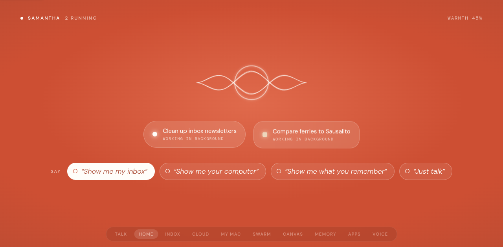
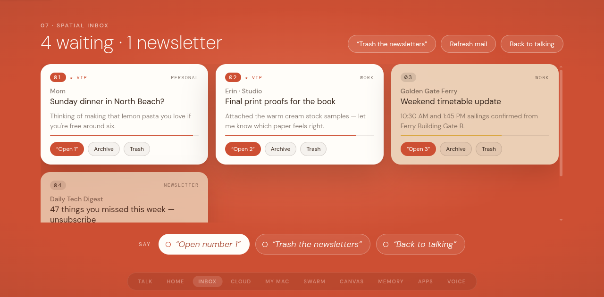
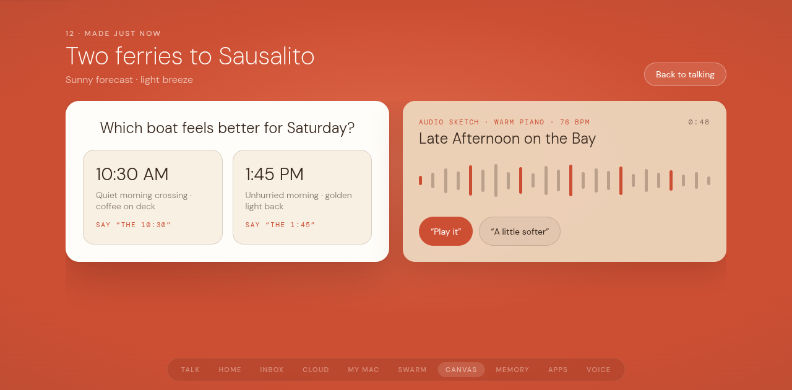
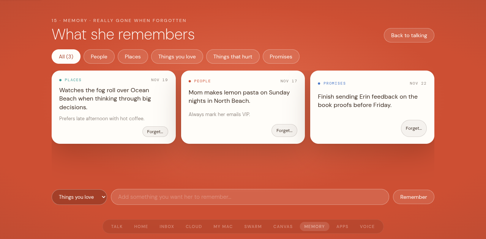

<div align="center">
  
  <h1>OS<sup>1</sup></h1>
  <p>
    <strong>A <em>Her</em>-inspired, voice-first personal operating system.</strong><br />
    Dual-brain realtime voice · Three.js presence · Jev generative UI · Hermes background agent · Composio connectors · Bounded two-computer use
  </p>
  <p>
    <a href="LICENSE"></a>
    
    
    <a href="docs/architecture.md"></a>
  </p>
  <br />
  
</div>

---

## Philosophy

Most AI assistants look like chat logs with a microphone bolted on. **OS¹** is built around four principles:

1. **Three loops at three speeds.** *Presence* (100–600 ms: listening, speaking, interruptions, UI choreography), *Work* (seconds to minutes: deep background runs on Hermes + Claude Opus), and *Ambient* (async: Composio webhooks, scheduled jobs, memory curation). Presence never waits on Work.
2. **Calm coral horizon by default.** The screen stays quiet while you talk. Tactile paper & studio surfaces materialize only when seeing something genuinely helps — driven by **Jev** (~100 ms System One judgments with anti-flicker hysteresis) — and dissolve cleanly when the conversation moves on.
3. **Voice-native, speakable UI.** Every control on screen carries a `speakablePhrase` (*"The 1:45"*, *"Open number 1"*, *"Trash the newsletters"*, *"Let me drive"*, *"Undo that"*). Spoken matches resolve deterministically on the orchestrator with **zero LLM latency**.
4. **Risk-tiered trust & real forgetting.** Low-stakes actions run with a **60-second undo queue**; outbound messages ask once; money and permanent forgetting require read-back confirmation, hard caps, and server-verified one-time approval tokens. *"Yes, forget it"* purges both the SQLite ledger and Hermes memory files.

---

## Surfaces

| Desktop Home (`06`) | Spatial Inbox (`07 / 08`) |
| :---: | :---: |
|  |  |
| **Made Just Now — Generative UI (`12`)** | **Memory Ledger (`15`)** |
|  |  |

Also included in the desktop app:
- **3D Infinity Startup & Waking Loop:** Continuous 260×10 Bishop-frame Three.js WebGL helix → circle morph with custom Fresnel/depth shaders, volumetric glow, gossamer echo filament, and live `AnalyserNode` audio reactivity.
- **Movie-Style First-Run Onboarding:** Deterministic Operator agent (`01 Boot` → `02 Setup` Q1–Q3 with Jev hesitance & mid-answer cut-off → `03 Waking` → `05 Naming`) that hands off seamlessly into Samantha inside the same LiveKit room.
- **Two Computers (`09` & `10`):** Watch Samantha's dedicated cloud VM live via embedded **noVNC** (`10 Her Computer`) with a *"While you were away"* log, while her access to your own Mac (`09 Your Computer`) runs strictly as a last resort through an outbound authenticated **Cua Driver** tunnel in `bounded` mode with a global **`Cmd+Shift+Escape` / *"Let me drive"*** kill switch.
- **Swarm (`11`), Connectors (`13`), Voice (`14`), & S2 Modals:** Live parallel task cards, runtime per-app Composio policies (*"Mail · asks before sending"*), two-voice Fish Drama 3 presets & spoken tweaks (*"A little warmer"*, *"Slow down"*), and unified risk-tiered confirmation modals.

---

## Architecture

```text
 OS¹ Desktop Client (Electron + React + Three.js + noVNC)
  ├─ mic / speaker ────────────── LiveKit WebRTC room ─────────────────┐
  ├─ live UI state ◀── WS /os1/events ───┐                             │
  ├─ voice/tap pills ── POST /os1/actions┤                             │
  └─ Cua Driver (bounded, outbound WSS)──┼──────────┐                  │
                                         ▼          │                  ▼
 ┌─ OS¹ ORCHESTRATOR (:8787) ───────────────────────┼─┐  ┌─ VOICE STACK (:8788 / worker) ──┐
 │  SQLite Memory Ledger · Connector Policy Table   │ │  │  Dual-engine:                   │
 │  Zero-LLM Speakable-Pill Matcher                 │ │  │   • drama3 (LiveKit + Fish TTS) │
 │  Jev UI Director (hysteresis + mood + triage)    │ │  │   • live3  (Fish Live 3 + brain)│
 │  Unified PendingAction Bus + 60 s Undo Queue     │ │  │  Fast Brain: streaming Sonnet   │
 │  Composio v3 Tool Router (Connect Links + Gmail) │ │  │  Jev Turn Router (~100 ms)      │
 │  Orgo VNC WSS Proxy · Cua Tunnel Relay ◀─────────┘ │  └──────────────┬──────────────────┘
 └──────────────────────────┬─────────────────────────┘                 │ /v1/runs (async)
                            ▼                                           ▼
 ┌─ HERMES AGENT (Dedicated Cloud VM / Orgo, :8642) ───────────────────────────────────────┐
 │  Claude Opus main brain · SOUL.md · MEMORY.md / USER.md · cron · native computer_use    │
 │  Plugins: os1_ui · os1_memory · os1_composio · os1_user_computer                        │
 └─────────────────────────────────────────────────────────────────────────────────────────┘
```

Read the full system design in [`docs/architecture.md`](docs/architecture.md).

---

## Repository Layout

| Path | Description |
| --- | --- |
| `apps/desktop` | Electron shell, IPC config bridge, embedded bounded `CuaTunnelHost`, global kill switch |
| `packages/ui` | Reusable React + Three.js + noVNC surfaces (`StartupSequence`, `01`–`15`, `S2 Modals`) |
| `services/orchestrator` | FastAPI state bus, SQLite ledger, zero-LLM pill matcher, Jev UI Director, Composio v3 client, VNC & Cua relays |
| `services/voice` | LiveKit Agents worker (`drama3`), Fish Live 3 custom LLM brain server (`live3`), Operator onboarding, Jev turn router |
| `hermes/` | `samantha` Hermes profile (`SOUL.md`, `config.yaml`), installer, and 4 Hermes plugins (`os1_ui`, `os1_memory`, `os1_composio`, `os1_user_computer`) |
| `scripts/` | Desktop launcher, dry-run-by-default Orgo deploy script, Fish Live 3 agent publisher |
| `docs/` | Full architecture & research notes (Hermes, Fish Audio, Jev, Composio, Cua Driver) |

---

## Quickstart

### Prerequisites
- **Node.js 22+** and **[uv](https://docs.astral.sh/uv/)** (Python 3.12+)
- API keys in `.env` (see `.env.example`): **Anthropic**, **LiveKit Cloud**, **Fish Audio** (Drama 3), and optionally **TypeSafe / Jev**, **Composio**, and **Orgo**

### 1. Clone & enable the pre-commit secret guard
```bash
git clone https://github.com/nickvasilescu/os1-her.git
cd os1-her
git config core.hooksPath .githooks
cp .env.example .env    # fill in your keys (never commit .env)
npm install
```

### 2. Preview any UI surface immediately (no API keys required)
```bash
OS1_PREVIEW="startup&motion" npm run dev   # 3D infinity startup sequence
OS1_PREVIEW=home npm run dev               # 06 Desktop Home
OS1_PREVIEW=inbox_cascade npm run dev      # 07 Spatial Inbox
OS1_PREVIEW=made_just_now npm run dev      # 12 Generative UI cards
OS1_PREVIEW=her_computer npm run dev       # 10 Her Computer (noVNC)
OS1_PREVIEW=your_computer npm run dev      # 09 Your Mac (Cua bounded fence)
OS1_PREVIEW=memory npm run dev             # 15 Memory Ledger
OS1_PREVIEW=connectors npm run dev         # 13 Connectors
OS1_PREVIEW=voice_picker npm run dev       # 14 Voice
OS1_PREVIEW=modal_forget npm run dev       # S2 Read-back Confirmation Modal
```

### 3. Run the full stack locally
```bash
# 1. Install the Hermes profile + 4 OS1 plugins and start Hermes API server (:8642)
./hermes/install-profile.sh
hermes -p samantha gateway run

# 2. Orchestrator state bus (:8787)
(cd services/orchestrator && uv run uvicorn os1_orchestrator.app:app --port 8787)

# 3. Voice worker (Onboarding + Drama 3 voice engine)
(cd services/voice && uv run python -m os1_voice.worker download-files)  # first run only
(cd services/voice && uv run python -m os1_voice.worker dev)

# 3b. Optional: Fish Live 3 brain server (:8788, requires public HTTPS)
(cd services/voice && uv run uvicorn os1_voice.brain_server:app --host 127.0.0.1 --port 8788)
python3 scripts/fish_live3_agent.py https://<public-url-of-8788>

# 4. Desktop app
npm run dev
```

*(Optional local startup audio: if you have your own licensed boot sound, drop it at `packages/ui/src/assets/init_sound.mp3` — gitignored — and `StartupSequence` will automatically lock the 3D WebGL animation and `AnalyserNode` bloom to it. Without it, the app falls back to synthesized WebAudio.)*

---

## Deploying to a Cloud VM (Orgo)

`scripts/deploy_orgo.py` defaults to a **safe dry-run** that prints the bundle file count and target VM without modifying anything:

```bash
python3 scripts/deploy_orgo.py          # dry-run (safe default)
python3 scripts/deploy_orgo.py --apply  # upload services/ + hermes/ + .env and restart Supervisor
```

---

## Security & Safety Controls

See [`AGENTS.md`](AGENTS.md) for the full control matrix. Highlights:
- **Fail-closed auth:** Orchestrator routes fail closed (`503`) if `OS1_CLIENT_TOKEN` is unset; Composio webhooks fail closed (`503`) if `COMPOSIO_WEBHOOK_SECRET` is unset.
- **No model self-approval:** `os1_composio` rejects writes/messages/payments without a server-minted, one-time human-confirmed `approval_id`, enforces `OS1_MAX_PAYMENT_USD` with explicit `currency` + `amount_cents`/`amount_usd`, and checks `OS1_ALLOWED_RECIPIENTS`.
- **Bounded Mac access:** `apps/desktop/src/main/cuaHost.ts` connects outbound only (zero local ports), restricts file access to `~/Desktop`, `~/Documents`, `~/Downloads`, blocks Terminal/Keychain/System Settings/password managers, disables telemetry, and binds **`Cmd+Shift+Escape`** globally to revoke all permissions immediately.
- **Local-only test guards:** `conftest.py` in both Python services aborts pytest if any DB/service URL points to a non-local host.

---

## Tests & Lint

```bash
(cd services/orchestrator && uv run ruff check . && uv run pytest -q)
(cd services/voice && uv run ruff check . && uv run pytest -q)
npm run typecheck
npm run build
```

---

## License

[MIT](LICENSE)
